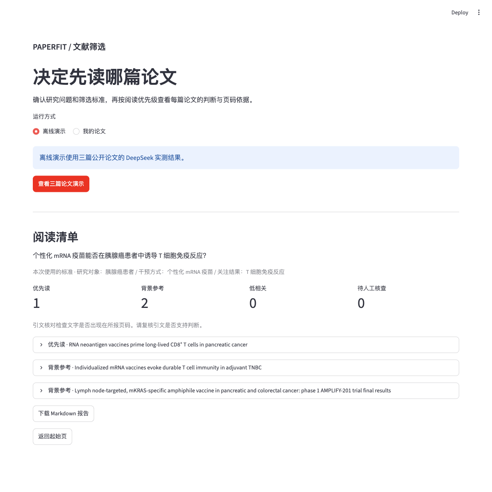

# PaperFit Agent

PaperFit 帮助生物医药从业者按一个研究问题筛选一小批英文论文。用户确认研究对象、干预方式、关注结果和研究类型。程序逐篇判断相关性，核对引文和 PDF 页码，并生成阅读清单。

## 启动

```bash
python3 -m venv .venv
.venv/bin/python -m pip install -r requirements.txt
.venv/bin/python -m streamlit run app.py --server.address 127.0.0.1
```

打开终端显示的本地地址，点击「查看三篇论文演示」即可查看三篇公开论文的 DeepSeek 实测结果。可展开完整论文标题查看判断、引文和页码，也可下载报告。演示直接读取已保存的结果，无需密钥。点击「返回起始页」可清空当前会话的筛选结果和输入。

切换到「我的论文」，输入问题和 DeepSeek API 密钥，上传 1～20 篇 PDF。要在本机保存密钥，运行 `.venv/bin/python setup_deepseek.py`，在终端隐藏输入。密钥会存入 Git 忽略的 `.env.local`，网页和 CLI 会自动读取。环境变量 `DEEPSEEK_API_KEY` 优先。确认标准后点击「开始筛选」。留空表示未限定。DeepSeek Flash 使用低档思考，实际运行会将研究问题及提取的论文文字发送给 DeepSeek。

选择「帮我找论文」时，只需填写研究问题。PaperFit 根据问题生成英文检索式，在 Europe PMC 中读取首轮最多 20 条候选，检索范围包含预印本等不同来源。候选不足或直接相关的原始研究较少时，再补搜最多 10 条。合并去重后按摘要初筛，并尝试获取最多 5 篇全文。可查看每轮检索式、命中数、候选来源及预印本标记。论文能否进入清单仍取决于收录范围、检索词和排序。

搜索模式优先使用受支持来源的开放 PDF，也支持 Europe PMC 的开放结构化全文。PDF 证据标出页码，结构化全文证据标出章节与段落编号。无法取得可筛选全文时，会保留摘要或书目信息以及原文链接。

原有命令行也可运行单篇筛选：

```bash
.venv/bin/python screen_paper.py "/path/to/paper.pdf"
```

## 工作流

1. 用户手动填写筛选标准，或先接受 DeepSeek 建议再逐项编辑。
2. 每篇按 PDF 页提取文字，并记录文字少于 50 个字符的页。
3. DeepSeek 对启用的标准返回结构化判断、理由、引文和 PDF 页码。
4. 程序把引文和所报页的文本做归一化比较。核对失败或判断缺失时，只针对相关维度请求一次修正。仍未核对的维度保留为「待核对」。
5. 程序按以下规则分类。打开失败、文字提取失败或模型请求失败的文件进入「待人工核查」，同批其他文件继续处理。

| 分组 | 规则 |
| --- | --- |
| 优先读 | 所有启用的标准都匹配，且每条判断都有定位成功的引文 |
| 背景参考 | 所有标准均有可定位的引文，且判断包含部分匹配，或混合了匹配与不匹配 |
| 低相关 | 所有标准均有可定位的引文，且全部不匹配 |
| 待人工核查 | 有待核对、证据不足或处理失败 |

引文核对只验证文字和页码，是否支持模型判断需要人工复核。扫描页、图片和难以提取的表格可能缺少证据。首版逐篇提交可提取文字，单篇限制为 50 万字符，超限会提示拆分。

`criteria.py` 负责 DeepSeek 请求和标准建议，`read_pdf.py` 负责提取文字，`screen_paper.py` 负责判断和引文修正，`paperfit.py` 负责批量处理和报告，`app.py` 负责交互。

验收样例和当前评测边界见 [评测记录](docs/evaluation.md)。



## 开源许可

PaperFit 的项目代码采用 [GNU AGPL-3.0](LICENSE)。依赖库沿用各自的许可。演示中的论文标题和短引文标有原文链接。示例论文 PDF 由各出版商提供。
