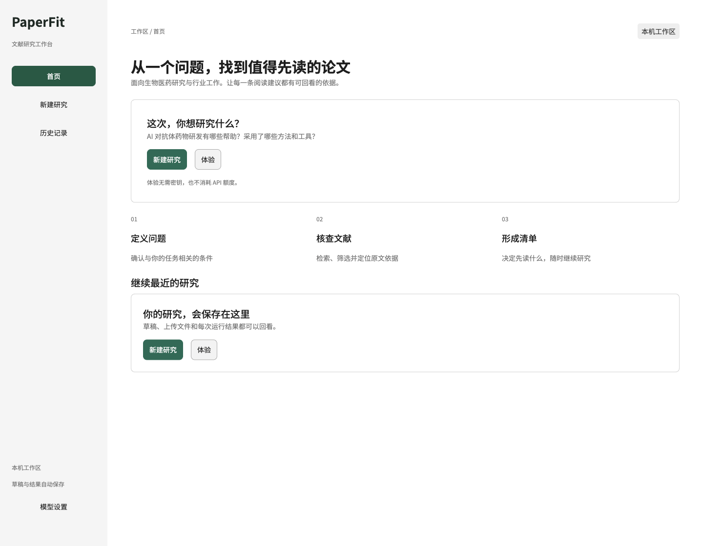
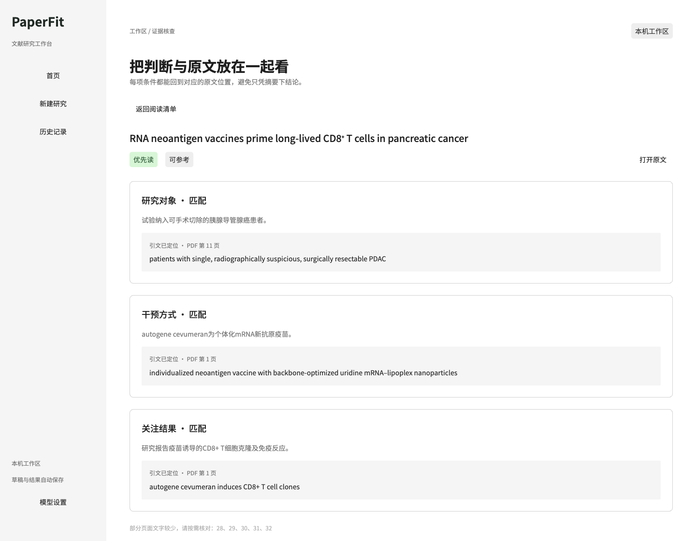

# PaperFit

**从研究问题到有依据的阅读清单。**

PaperFit 是面向生物医药从业者的文献研究 Agent：根据研究问题查找论文，按用户确认的条件核查证据，整理阅读优先级，并保存每次研究的过程与结果。适用于前沿进展调研、方法比较和药物研发等文献研究任务。

[快速启动](#快速启动) · [使用流程](#使用流程) · [产品设计](#产品设计) · [评测记录](docs/evaluation.md)


## 可以做什么

| 能力 | 当前实现 |
| --- | --- |
| 自动找论文 | 规划检索词、搜索 Europe PMC、去重与摘要初筛、获取开放全文 |
| 筛选自己的文献 | 上传 1–20 篇 PDF，逐篇处理，单篇失败不阻断其他论文 |
| 确认研究条件 | AI 建议或手动填写 1–12 项条件，可增删改，区分「优先考虑」与「必须满足」 |
| 核查判断依据 | 查看每项判断、短引文及 PDF 页码或全文章节；引文定位失败时尝试修正一次 |
| 决定先读什么 | 按优先读、背景参考、低相关、待人工核查分组，支持单篇重试和 Markdown 导出 |
| 保留研究历史 | 自动保存草稿、上传文件、执行记录和结果版本，刷新后可恢复；重跑保留旧版本 |
| 无密钥体验 | 使用真实论文的历史筛选结果体验界面，不发起模型请求，不产生 API 费用 |

## 快速启动

需要 **Python 3.10 或以上**。首次安装依赖需要联网。以下命令从源码运行当前版本。

先获取项目；也可以使用 GitHub 的 **Code → Download ZIP** 下载并解压，然后在项目目录打开终端。

```bash
git clone https://github.com/LiaoJiakun/PaperFit.git
cd PaperFit
```

### macOS / Linux

```bash
python3 -m venv .venv
.venv/bin/python -m pip install -r requirements.txt
.venv/bin/python -m streamlit run app.py --server.address 127.0.0.1
```

### Windows（PowerShell）

```powershell
py -3 -m venv .venv
.venv\Scripts\python.exe -m pip install -r requirements.txt
.venv\Scripts\python.exe -m streamlit run app.py --server.address 127.0.0.1
```

打开终端显示的本地地址，通常为 **http://localhost:8501**。第一次可直接点击 **体验**。请在项目根目录运行，以便加载 `.streamlit/config.toml` 和本地字体。更新源码后，停止旧服务并重新启动。

当前新版已在 macOS 本地浏览器验证；Windows 启动命令供源码运行使用，本次未重新构建或验证 Windows 安装包。此前的打包版本不代表本仓库的最新界面。

## 使用流程

1. **新建研究**：填写具体问题，例如「AI 在抗体药物研发中有哪些应用？效果如何，使用了哪些方法和工具？」。
2. **配置模型**：进入侧栏的「模型设置」，填写自己的 DeepSeek API 密钥，点击「保存到本机」。已有配置可直接使用。
3. **选择来源**：「自动找论文」或「上传 PDF」。
4. **确认条件**：点击「让 AI 建议」或自行添加；逐项编辑要求，选择「优先考虑」或「必须满足」。条件不限定为固定的 PICO 字段。
5. **开始核查**：点击「确认条件并开始」。每完成一篇就保存一篇；单篇失败可随后重试。
6. **阅读与复核**：在清单中查看推荐理由，点击「查看依据」进入证据详情，核对引文位置，也可打开原文或导出报告。
7. **继续研究**：从「历史记录」恢复草稿或打开旧版本；修改条件后重新运行会生成新版本。

「新建研究」不会删除旧任务。输入框编辑提交后自动保存；刷新或重启后可从历史恢复。中断的旧运行不会自动恢复网络请求。删除任务需要再次确认。

<details>
<summary>查看首页与证据详情</summary>





</details>

## Agent 如何工作

用户确认问题与条件 → 模型规划检索词 → 数据库搜索与去重 → 摘要初筛 → 获取开放全文 → 逐项核查 → 程序定位引文 → 整理阅读清单。

执行结果会影响下一步：候选不足或直接匹配较少时补搜；引文无法定位时返回原文尝试修正一次；全文不可得或修正后仍缺少证据时，保留为「待人工核查」。用户可以修改条件或重试失败论文，原结果版本继续保留。

### 检索与证据范围

- **来源**：Europe PMC 收录的不同来源，包含预印本，不限定于 PubMed；目前未接入所有论文数据库。
- **自动检索预算**：首轮最多 20 条候选，最多补搜 10 条；去重后按摘要初筛，为最多 5 篇尝试获取开放全文。数据库总命中数不等于实际筛选数。
- **上传预算**：1–20 篇 PDF，单篇提取文字上限为 50 万字符。
- **证据位置**：PDF 标注页码；结构化全文标注章节与段落。未获取全文时保留摘要或书目信息，明确提示证据不足。
- **人工核查**：扫描页、图片和表格可能无法充分提取；当前未内置 OCR，可先做文字识别，再上传带文字层的 PDF。

| 分组 | 主要规则 |
| --- | --- |
| 优先读 | 所有启用条件均匹配，且引文可定位 |
| 背景参考 | 部分匹配或存在差异；综述、评论等至多作为背景参考 |
| 低相关 | 所有条件均明确不匹配，或可定位证据明确否定某项必须条件 |
| 待人工核查 | 证据不足、引文无法定位、全文不可得、必须条件尚不明确或处理失败 |

条件明确不符和证据不足分别处理，不把未知当作排除。阅读优先级、证据状态与条件符合情况保存在结果中，清单和详情提供对应提示。

**引文定位只验证文字出现的位置，不保证其充分支持判断。** 仍需结合研究设计和原文复核。该工具帮助安排阅读优先级，不提供诊疗决策，也不宣称完成穷尽性检索或系统综述。

## 数据与模型配置

| 数据 | 保存位置与行为 |
| --- | --- |
| 草稿、结果版本、执行记录 | 本机 `~/.paperfit/history.sqlite3` |
| 上传 PDF 副本 | 本机 `~/.paperfit/files`，按内容哈希去重 |
| DeepSeek 密钥 | 项目目录的 `.env.local`，已被 Git 忽略，不进入历史或导出报告 |
| 离线体验结果 | 仓库中的 `demo_results.json`，含论文来源和引文位置 |

默认使用 `criteria.py` 中配置的 **DeepSeek Flash、低档思考**。真实运行会将问题、条件和论文文字发送给 DeepSeek，使用用户自己的 API 额度。页面输入优先于环境变量 `DEEPSEEK_API_KEY`，环境变量优先于 `.env.local`。也可在虚拟环境中运行 `python setup_deepseek.py` 隐藏输入密钥。

删除任务时清理不再被其他任务或版本引用的上传文件。当前是本机单人版本，没有账户、云同步或团队权限。可用环境变量 `PAPERFIT_DATA_DIR` 指定历史数据目录。分享源码或安装包时不要包含本机密钥、历史数据库或个人上传文件。

## 产品设计

[Figma 界面与点击原型](https://www.figma.com/design/S3vnBBNd75RVTfuQikGvZN) · [FigJam 业务流程](https://www.figma.com/board/sEEPCGYYe5PNiFU8RT0QB2) · [完整改版方案](docs/product-redesign.md)

本地应用已按 Figma 的页面结构、字体、颜色、间距、卡片与状态样式实现。覆盖首页、研究设置、阅读清单、证据核查、历史、执行过程、部分失败、空状态、模型设置和删除确认；真实调用与数据保存由本地应用执行。设计到代码已在本次版本同步，后续设计修改仍需更新代码。

界面采用 Noto Sans SC 本地字体，运行时不依赖外部字体服务。样式集中在 `static/paperfit.css`，通用界面组件在 `ui.py`。

## 验证与项目结构

截至 2026-11-06，自动化检查通过 **21 次用例执行**，包含存储测试在独立环境和界面环境中重复执行。覆盖条件编辑与传递、历史恢复、版本保留、删除确认、离线体验、失败隔离、重试和会话密钥保留；流程测试使用固定响应，不消耗 API 额度。

在上面的虚拟环境中运行：

```bash
python -m unittest discover -s tests -v
```

若未激活虚拟环境，macOS / Linux 使用 `.venv/bin/python`，Windows 使用 `.venv\Scripts\python.exe` 替换 `python`。

macOS 浏览器已检查主要交互及 1440px、1200px、900px 窗口布局。真实论文筛选、引文检查和模型烟测的记录见 [评测记录](docs/evaluation.md)；现有样例用于验证流程，不代表大样本准确率、召回率或时间节省测量。体验采用真实调用后保存的结果，不补造未记录的搜索过程。

| 模块 | 职责 |
| --- | --- |
| `app.py` / `ui.py` / `static/` | 页面、交互和设计样式 |
| `product_rules.py` | 动态条件与必须条件规则 |
| `literature_search.py` | 有界检索、候选初筛及全文获取 |
| `screen_paper.py` / `paperfit.py` | 筛选、引文核验、批处理与报告 |
| `history.py` | 本地草稿、文件和结果版本存储 |
| `criteria.py` / `setup_deepseek.py` | 模型请求和密钥配置 |
| `tests/` | 自动化回归检查 |

`scripts/expand_experience.py` 用于通过真实 API 调用扩充体验数据，会产生费用，已有 DOI 会跳过。

## 开源许可

项目代码采用 [GNU AGPL-3.0](LICENSE)，依赖库沿用各自的许可。Noto Sans SC 使用 [SIL Open Font License](static/fonts/OFL.txt)。体验中的标题与短引文附有原文链接，论文全文未打包进仓库，完整论文的权利归各出版商或作者。
